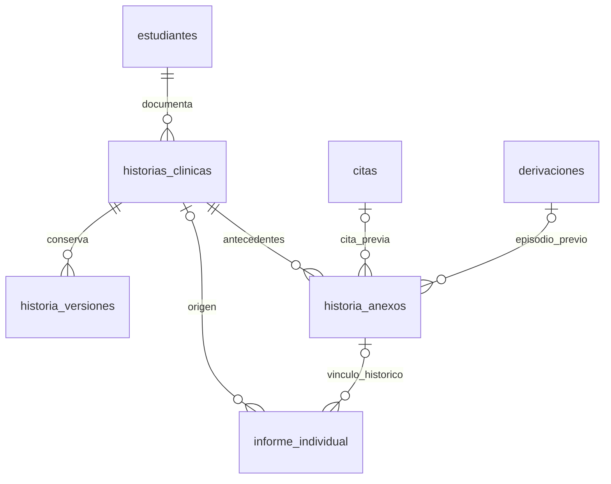

# Retiro definitivo del módulo independiente de Seguimientos

Fecha: 20/11/2026, America/La_Paz. Se conserva el título y alcance del proyecto: Sistema web de registro de citas y seguimiento de historias clínicas psicológicas de estudiantes de la U.E. Cañada Pailita «B».

## Resultado implementado

El seguimiento psicológico se realiza en **Estadísticas y análisis → Seguimiento psicológico individual** mediante historias clínicas y versiones documentales conservadas. La carpeta `seguimientos/` y sus cuatro archivos se eliminaron. No quedan formularios, enlaces, permisos ni operaciones PHP de registro independiente. Las antiguas rutas, incluidas variantes de edición y eliminación, responden 404 por GET y POST para los cuatro roles.

Citas e Historias enlazan directamente a Estadísticas. El menú ya tenía Estadísticas y no necesitó duplicar entradas. Se retiraron los enlaces independientes de la trazabilidad y la referencia ambigua del acceso principal. Los estados «En seguimiento» de historias y derivaciones mantienen su significado clínico/administrativo; no representan un módulo.

La consulta general ofrece frecuencias, porcentajes, estudiantes distintos y distribución por mes, curso/paralelo y apartados clínicos. La consulta individual ofrece indicadores de historias y versiones, cronología y comparación de dos historias o versiones del mismo estudiante. Ambas permiten imprimir o guardar PDF desde el navegador. Continúan disponibles los informes mensuales con totales y filtros persistidos.

## Requerimientos funcionales vigentes

| Código | Requerimiento | Criterio de aceptación |
|---|---|---|
| RF-SEG-01 | Documentar cada atención en una historia clínica | No existe alta, edición ni eliminación de seguimientos independientes |
| RF-SEG-02 | Conservar las correcciones de historias | Estado anterior completo, opciones y familiares en `historia_versiones`; una edición no aumenta atenciones |
| RF-EST-01 | Consultar indicadores generales desde historias | Conteos coherentes con panel e informes nuevos; sin identidades ni notas en el resumen general |
| RF-EST-02 | Consultar historial individual | Selección de estudiante y acceso clínico obligatorio; cronología de historias y versiones reales |
| RF-EST-03 | Comparar registros clínicos | Solo registros del estudiante y período seleccionados; todos los apartados registrados y selecciones disponibles |
| RF-EST-04 | Filtrar por estudiante, curso, paralelo, gestión y período | Estudiante en consulta individual; resto de filtros disponibles en ambas consultas, con validación en servidor |
| RF-EST-05 | Describir diferencias documentales sin diagnosticar | No genera diagnósticos, mejoría ni desaparición de condiciones a partir de casillas o porcentajes |
| RF-EST-06 | Generar reportes estadísticos | Impresión/PDF de consultas filtradas; informe mensual guardado con instantánea de sus totales |
| RF-HIS-01 | Conservar antecedentes heredados | Anexos consultables dentro de su historia original, sin operaciones de mantenimiento propias |
| RF-INF-01 | Preservar informes anteriores | Autor, vínculos y totales almacenados no cambian durante migración o edición |

El filtro de gestión limita el año de la fecha de atención. Para curso y paralelo utiliza la última inscripción disponible de esa gestión; sin gestión utiliza la última inscripción por gestión, fecha e identificador. El período es inclusivo y termina como máximo hoy. Una inscripción adicional no multiplica historias. Sin filtro de curso/paralelo se incluyen historias de estudiantes sin inscripción en esa gestión y de estudiantes retirados. La consulta general usa el contenido actual; no reconstruye retrospectivamente el conocimiento de la institución.

## Casos de uso

| Caso | Actor y condición | Flujo y resultado |
|---|---|---|
| CU-01 Documentar atención | Psicóloga con permiso de creación de historias | Selecciona estudiante y, si corresponde, cita/derivación; guarda una historia; queda disponible en Estadísticas |
| CU-02 Corregir historia | Psicóloga con permiso de edición | Edita campos; transacción conserva versión anterior y auditoría; no aumenta atenciones |
| CU-03 Consultar seguimiento psicológico | Psicóloga con lectura de Estadísticas e Historias | Selecciona estudiante y filtros; consulta indicadores, cronología y anexos integrados |
| CU-04 Comparar evolución documental | Mismos permisos de CU-03 | Elige dos registros disponibles; consulta diferencias de textos, valoraciones y selecciones; una selección ajena o fuera de período es rechazada |
| CU-05 Consultar estadísticas generales | Psicóloga con lectura de Estadísticas | Filtra período/curso/paralelo/gestión/estado; consulta resultados agregados y sus denominadores |
| CU-06 Generar reporte | Consulta autorizada o permiso de creación de Informes | Imprime/guarda PDF de la consulta, o genera informe mensual persistido; las instantáneas anteriores no se recalculan |
| CU-07 Consultar antecedentes heredados | Psicóloga con lectura de Historias | Abre historia y sección del anexo enlazada desde Estadísticas; consulta literal de contenido conservado |

Se retiran los casos de uso de registrar, listar, visualizar, editar y eliminar seguimientos como entidad independiente. No existe «seguimiento calculado» persistido ni procesamiento diagnóstico automático.

## Roles y permisos

| Operación | Administrador | Psicóloga | Docente | Director / personalizado |
|---|---|---|---|---|
| Historias clínicas: consultar, crear, editar | Bloqueado | Según permiso de acción | Bloqueado | Bloqueado |
| Seguimiento psicológico individual en Estadísticas | Bloqueado | Lectura de Estadísticas y de Historias | Bloqueado | Bloqueado |
| Estadísticas generales / panel | Bloqueado | Según permiso de consulta | Bloqueado | Bloqueado |
| Anexos clínicos históricos | Bloqueado | Dentro de historias, solo lectura | Bloqueado | Bloqueado |
| Registrar/editar/eliminar seguimiento independiente | Inexistente | Inexistente | Inexistente | Inexistente |
| Informes | Bloqueado | Según permiso por acción | Bloqueado | Bloqueado |

Las demás acciones conservan la política de [privacidad y accesos](../seguridad/10_PRIVACIDAD_ACCESOS.md). Se elimina el módulo en `modulos` y sus filas de `permisos`. La política conserva una denegación explícita del nombre histórico para impedir concesiones residuales o manipuladas; no concede ninguna operación. No se amplía acceso clínico a administración o dirección. Las escrituras vigentes siguen exigiendo POST y CSRF.

## Modelo de datos y migración 017

`historia_anexos` constituye el archivo heredado dependiente de las historias, sin controlador ni formulario propio. Conserva autor, fecha clínica, fecha de registro, descripción, técnicas aplicadas, acuerdos, recomendaciones, próxima sesión prevista y relaciones con cita, derivación y próxima cita. Los informes anteriores mantienen un vínculo opcional mediante `cod_anexo_historico`; los nuevos no lo crean.

Se utilizó `RENAME TABLE` para transformar el archivo completo, conservando también índices, claves salientes y columnas adicionales de una instalación. Se renombraron el identificador original a `cod_anexo` y la columna del detalle de informes a `cod_anexo_historico`, restableciendo su FK. No se ejecutó un `DROP TABLE` sobre las notas ni se copiaron textos a campos clínicos con otro significado. La tabla con nombre `seguimientos` deja de existir; no se conserva una vista de compatibilidad con ese nombre.

El planificador inspecciona claves entrantes, vistas, procedimientos/funciones, triggers y eventos. Bloquea objetos adicionales que requieran resolución y la coexistencia de dos archivos, para evitar sobrescrituras. Los identificadores técnicos heredados de algunos índices/FK salientes pueden conservar sus nombres internos; sus referencias apuntan al archivo integrado y no habilitan rutas ni módulos.

El ejecutor comprueba una copia cifrada de la misma base, de las últimas 24 horas, con integridad/autenticidad verificadas y clave en otra carpeta fuera de la raíz web. Exige mantenimiento y bloqueo de migración. Compara SHA-256 por valores de todas las filas del archivo y detalle de informes antes/después; también comprueba integridad referencial. La prueba dedicada replanifica después de cada sentencia para ensayar recuperación frente al DDL no transaccional. No se desactivan las claves foráneas durante el retiro.

El SQL de instalación ya crea el archivo integrado sin módulo ni permisos retirados. La migración 006 dejó de recrear ese módulo y 013 evita consultar una tabla inexistente después del retiro. La marca histórica 015 conserva su identificador. Procedimiento reproducible en [database/README.md](../database/README.md).

## Ejecución sobre la base local

- Base: `psicologia_db`. Copia completa cifrada creada antes de modificar los datos y restaurada correctamente en destino aislado.
- Copia: `C:/xampp/private/retiro_seguimientos_20261120/copias/respaldo-20261120-135659-80f2bddd28cd`. Clave en la carpeta separada `claves`, fuera de la raíz web; no se incluye en Git.
- Aplicación del plan: diez operaciones, incluida la marca 015 pendiente y el retiro 017. Archivo previo: cero filas; detalle de informes: una fila. Valores verificados sin cambios.
- Comparación adicional con la copia restaurada: coincidencia de historias, versiones, anexos, cabeceras y detalle de informes por huellas; sin mostrar contenido clínico.
- Resultado: 45 claves foráneas sin huérfanos, tres vistas conservadas, cero referencias FK a la tabla retirada, cero módulos retirados y cero operaciones pendientes. Se retiró mantenimiento al finalizar las comprobaciones.

## Pruebas ejecutadas con datos ficticios

Los recorridos funcionales usan bases desechables `psicologia_test_*`, tablas temporales, personas y cuentas sintéticas. No se copiaron expedientes reales a esas fixtures. La recuperación de la copia local fue una comprobación operativa aislada, separada de los recorridos funcionales.

| Suite | Resultado final |
|---|---|
| `retirar_seguimientos.php` | 87 comprobaciones: conservación exacta, campos adicionales, informes heredados, dependencias SQL, FK, reanudación, mantenimiento obligatorio incluso después de renombrar, idempotencia, carpeta y rutas autorizadas ausentes |
| `seguimiento_clinico.php --navegador` | 224 comprobaciones; Chrome: 19 a 1440 px, 19 a 390 px y 19 a 360 px |
| `seguridad.php` | 1087 comprobaciones; matriz de 62 rutas, cuatro roles, métodos, CSRF, sesiones, propiedad y navegación |
| `fases.php` | 53 comprobaciones: permisos, estados, autoría, citas, historias múltiples, panel y mensuales |
| `informes_actualizacion.php` | 30 comprobaciones de persistencia, vínculos heredados y rollback |
| `historias_derivaciones.php --navegador` | 215 comprobaciones y 19 en Chrome |
| `trazabilidad.php --navegador` | 166 comprobaciones y 35 en Chrome; flujo derivación → cita → historia → estadísticas → informe |
| `esquema_informes_importacion.php --navegador` | 348 comprobaciones y 10 en Chrome: instalación, migraciones, estudiantes, docentes, CSV e informes concurrentes |
| `migracion_identidad_academica.php` | 12 comprobaciones |
| `endurecimiento.php` con sodium | 88 comprobaciones; sesiones/revocación, versiones, auditoría y recuperación cifrada con carga ficticia |
| `avisos.php` | 12 controles PHP/navegador; 47 condiciones por ancho a 1440, 768, 390 y 320 px |

La suite clínica prueba GET y POST de siete nombres de endpoint antiguos para los cuatro roles, sin escrituras; validación de filtros y gestión; ausencia de duplicados; aislamiento entre estudiantes; escape de contenido; consultas auditadas; diferencia entre población vacía y fallo SQL. Chrome comprueba filtros, indicadores individuales, comparación de versiones, ausencia de navegación al módulo eliminado y ausencia de desbordamiento. Se inspeccionó la captura sintética de 360 px; las capturas quedan fuera del repositorio en `C:/xampp/private/retiro_seguimientos_20261120/capturas`.

Las pruebas también ejercitan los avisos/notificaciones existentes y sus accesos. No se modificaron los cambios locales previos de `asset/css/avisos.css`, `asset/js/avisos.js`, `includes/header.php`, `login.php` y `tests/avisos_fixture.php`.

Verificación final: sintaxis correcta en los 140 PHP del proyecto fuera de bibliotecas de terceros. Apache local respondió 200 en el acceso y 404 en los cuatro endpoints retirados; la carpeta no existe y mantenimiento quedó desactivado. Se conservaron los finales de línea de Windows presentes en el repositorio.

## Inventario de archivos de esta intervención

| Área | Archivos modificados |
|---|---|
| Acceso y navegación | `config/permisos.php`, `index.php`, `citas/formulario.php`, `historias_clinicas/listar.php` |
| Dependencias históricas | `citas/datos.php`, `derivaciones/eliminar.php`, `includes/trazabilidad_datos.php`, `includes/trazabilidad_vista.php`, `historias_clinicas/ver.php` |
| Estadísticas | `estadisticas/clinica_datos.php`, `estadisticas/clinica_vista.php`, `estadisticas/index.php`, `estadisticas/individual.php` |
| Informes | `informes/datos.php`, `informes/registrar.php`, `informes/antecedentes.php`, `informes/listar.php`, `informes/mensual.php`, `informes/ver_mensual.php` |
| Esquema y respaldo | `database/psicologia_db.sql`, `database/migrar.php`, migraciones normalizadas `006_roles_permisos_dinamicos.php` y `013_continuidad_atencion.php`, `herramientas/respaldar.php` |
| Pruebas | `tests/seguimiento_clinico.php`, `tests/seguridad.php`, `tests/seguridad_router.php`, `tests/trazabilidad.php`, `tests/trazabilidad_navegador.php`, `tests/fases.php`, `tests/historias_derivaciones.php`, `tests/informes_actualizacion.php`, `tests/esquema_informes_importacion.php`, `tests/endurecimiento.php` |
| Documentación | `README.md`, `CHANGELOG.md`, `database/README.md`, `tests/README.md`, `documentacion/SEGUIMIENTO_PSICOLOGICO_2026-11-19.md`, `seguridad/01_ALCANCE_POLITICA.md`, `seguridad/02_RIESGOS.md`, `seguridad/09_OPERACION_RECUPERACION.md`, `seguridad/10_PRIVACIDAD_ACCESOS.md` |

Archivos nuevos: `database/migrations_normalizadas/017_retirar_seguimientos.php`, `database/retiro_lib.php`, `tests/retirar_seguimientos.php` y este informe. `estadisticas/datos.php` conserva su función de adaptador; no necesitó cambios porque delega en las consultas clínicas actualizadas.

Archivos eliminados: `seguimientos/registrar.php`, `seguimientos/guardar.php`, `seguimientos/listar.php` y `seguimientos/ver.php`; se eliminó también la carpeta vacía. Los scripts auxiliares de edición y comprobación se retiraron después de usarlos.

## Incidencias resueltas y límites pendientes

Durante la adaptación se corrigieron expectativas antiguas de pruebas sobre redirecciones, formato de fecha y precarga de notas; referencias de fixtures a la tabla retirada; dos referencias residuales a una variable del arnés de permisos; y un caso de replanificación que repetía la eliminación de permisos ya retirados. Las suites afectadas volvieron a ejecutarse y pasaron sin esas incidencias.

No quedan fallos funcionales detectados en el alcance comprobado. Chrome informó que retuvo un perfil temporal de avisos bajo la carpeta temporal del usuario; las comprobaciones terminaron correctamente y ese perfil solo contiene fixtures. La revisión en dispositivos físicos, lector de pantalla y entrega/impresión física continúa fuera de la cobertura automatizada. Tampoco se reconstruyen versiones clínicas que nunca fueron conservadas ni se emiten conclusiones diagnósticas automáticas.
