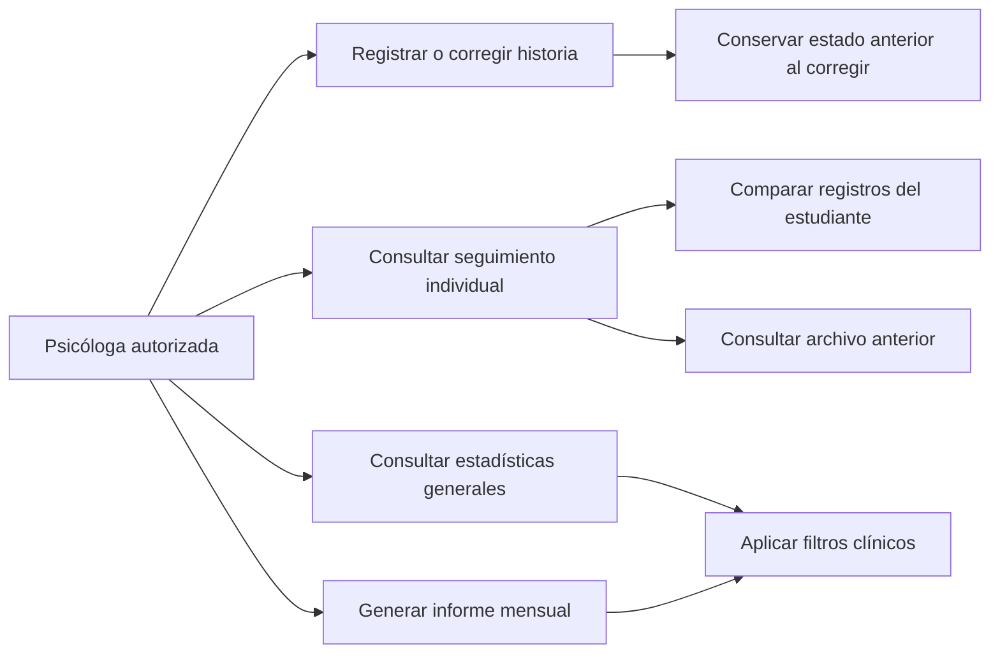
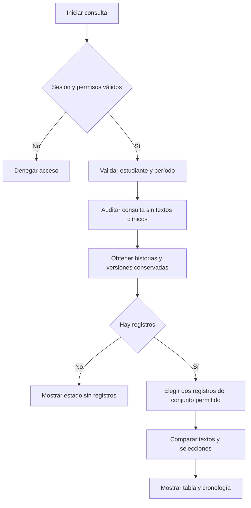
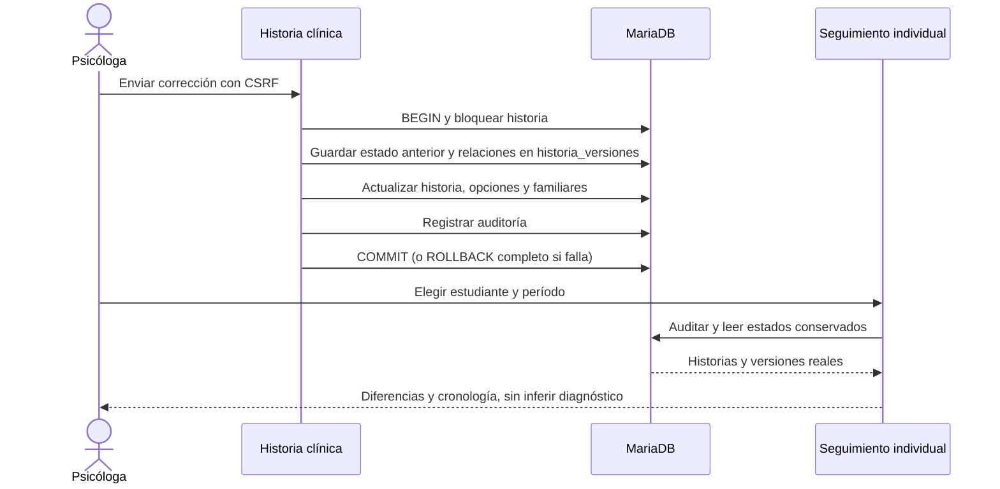
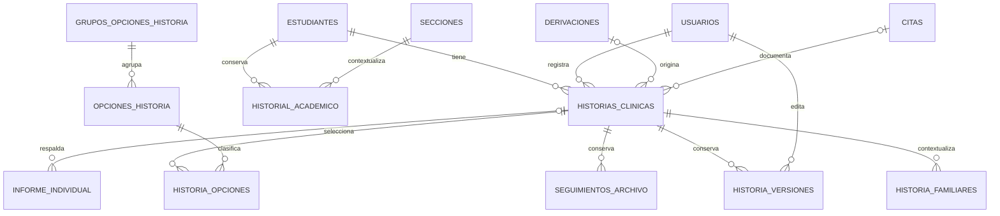

# Redefinición del seguimiento psicológico y las estadísticas

> Antecedente del 19/11/2026. La conservación de rutas antiguas y de la tabla original descrita aquí fue sustituida por el [retiro definitivo del 20/11/2026](RETIRO_SEGUIMIENTOS_2026-11-20.md). Ese informe establece los requisitos, casos de uso, modelo y resultados vigentes.

Fecha: 19 de noviembre de 2026. Proyecto: Sistema web de registro de citas y seguimiento de historias clínicas psicológicas de estudiantes de la U.E. Cañada Pailita «B».

## Resultado de la intervención

El seguimiento individual se consulta en **Estadísticas y análisis → Seguimiento psicológico individual**. Compara historias clínicas del estudiante y los estados anteriores que realmente se conservaron al editarlas. Las estadísticas generales agrupan las historias por fecha de atención. Se mantiene PHP, mysqli, MariaDB, Bootstrap y la arquitectura de páginas del proyecto.

El sistema describe cambios en los registros. No calcula diagnósticos, porcentajes de recuperación ni mejoría clínica. Las valoraciones profesionales se muestran como fueron escritas.

## Problemas identificados y soluciones

| Evidencia en el funcionamiento anterior | Efecto | Solución implementada |
|---|---|---|
| `seguimientos/listar.php` comparaba historias, pero `registrar.php`, `guardar.php` y `seguimiento_guardar()` todavía daban de alta registros independientes | Dos fuentes operativas para la evolución | Consulta única en estadísticas; alta retirada; archivo anterior conservado |
| Las estadísticas y los informes contaban filas de `seguimientos`, mientras el listado de historias llamaba sesiones a las historias | Totales incompatibles | Atención documentada = historia clínica; cada historia cuenta una vez |
| El inicio del rango no filtraba las historias usadas en frecuencias clínicas | Datos de otros períodos en los resultados | Rango inclusivo sobre `fecha_apertura` en las consultas generales y en los registros individuales |
| Las versiones transaccionales de `historia_versiones` no eran consultables en el seguimiento | Información conservada, pero sin comparación accesible | Selector de estados actuales y versiones, tabla de todos los apartados y cronología |
| Una casilla sin marcar se podía interpretar como ausencia o disminución clínica | Interpretación no sustentada | «Sin selección registrada», diferencias de marcas y aviso de ausencia no confirmada |
| Cerrar una derivación exigía un seguimiento independiente | Bloqueo del flujo nuevo | Se exige historia vinculada y cierre explícito desde derivaciones |
| La vista general incluía detalle nominal y las notificaciones podían incorporar nombres | Exposición innecesaria en una consulta agregada | Vista general sin expedientes ni notificaciones nominales; acceso clínico restringido |
| Las definiciones guardadas de los informes podían confundirse con la nueva | Comparaciones engañosas entre informes | Instantánea mensual con `version_semantica=2`; lector distingue los informes anteriores |

## Modelo funcional vigente

1. La profesional registra una historia por atención documentada. Puede vincular una cita y una derivación existentes.
2. Si corrige la historia, se conserva el estado anterior, incluidas opciones y familiares, dentro de la misma transacción. La edición no es una nueva atención.
3. En seguimiento individual selecciona estudiante, período, curso y paralelo actuales y, opcionalmente, estado de historia.
4. Selecciona dos registros de ese mismo estudiante y período. Pueden corresponder a historias diferentes o a versiones de una historia.
5. Consulta diferencias de textos, valoraciones, contexto familiar y selecciones, junto con la cronología documental.
6. Las estadísticas generales utilizan los estados actuales de las historias cuya fecha de atención está en el período.
7. Las citas y derivaciones cambian de estado mediante sus acciones explícitas. Consultar estadísticas, guardar un informe o editar una historia no las cierra automáticamente.

No existe una nueva entidad persistida «seguimiento calculado»: la consulta se deriva de las fuentes clínicas. Los enlaces antiguos se mantienen para compatibilidad y lectura del archivo.

## Fuentes, fechas e indicadores

| Elemento | Definición y fuente | Límite de interpretación |
|---|---|---|
| Historias / atenciones documentadas | Número de `historias_clinicas` filtradas; fecha `fecha_apertura` | Cuenta documentación de atención; no demuestra duración ni eficacia |
| Estudiantes con historia | Estudiantes distintos entre esas historias | No equivale a toda la matrícula del colegio |
| Porcentaje con marcas de riesgo | Estudiantes distintos con alguna selección del grupo `conductas_riesgo` en alguna historia del período / estudiantes con historia × 100 | No es prevalencia poblacional, gravedad ni estado clínico más reciente |
| Frecuencia de una opción | Historias con esa opción / historias incluidas × 100 | Selecciones múltiples pueden sumar más de 100%; las no marcadas no confirman ausencia |
| Falta de selección | Historias sin selección en un grupo | Desconocido; no se convierte en «no presenta» |
| Valoraciones | Distribución literal de situación escolar y valoración familiar | Incluye «Sin valoración registrada» en el denominador |
| Motivos de derivación | Categorías actuales de la derivación de origen | No reconstruye categorías antiguas que no se versionaron |
| Serie mensual | Historias agrupadas por mes de su fecha de atención | No incluye versiones ni el archivo de seguimientos |
| Panel principal | Historias hasta hoy y en los últimos 30 días; estudiantes distintos para prioridad | El período del panel puede diferir del elegido en estadísticas |
| Informe mensual nuevo | Mismos conteos clínicos del período; derivados administrativos de citas y derivaciones separados | El filtro de estado de historia afecta las historias, no redefine estados de citas o derivaciones |

Las fechas se interpretan en `America/La_Paz`. El rango es inclusivo; sin fecha inicial se incluyen todas las fechas disponibles hasta hoy. Curso y paralelo se obtienen de una única inscripción, ordenada por gestión, fecha inicial e identificador. Una inscripción histórica adicional no multiplica historias. Se conservan estudiantes retirados y sin inscripción cuando no se filtra por curso.

La cronología individual se ordena por fecha de atención, historia y orden de sus versiones. Muestra por separado la fecha de registro, la última actualización conservada y el instante en que se archivó una versión antes de editar. Una modificación documental posterior puede conservar la misma fecha clínica. La consulta por período usa el contenido actual y no es una reconstrucción de la base «tal como se conocía» en la fecha final.

## Apartados comparados

Se comparan todos los campos de `HISTORIA_TEXTOS`: fecha, tutor, talla, peso, valoración física, enfermedades, motivo, antecedentes, situación escolar, cursos repetidos, dificultades, materias, relaciones escolares, valoración y contexto familiar, evaluación inicial, impresión diagnóstica, plan, observaciones y estado. Se agregan los familiares y el motivo de cierre ya existentes.

Se comparan todos los grupos del catálogo y se conservan grupos históricos adicionales: conductas de riesgo, atención y distracción, actividad motora, adaptación a normas, dificultades socioemocionales y estrategias previas.

Los cambios posibles son registro nuevo, registro modificado, dato que deja de constar, permanencia, nuevas marcas y marcas que ya no aparecen. «Aumenta» o «disminuye» se refiere exclusivamente a la cantidad de selecciones, nunca a una intensidad clínica. Un campo vacío se muestra como no registrado. La opción explícita «Ninguna», cuando existe en el catálogo, se conserva como texto registrado.

El modelo no dispone de un campo estructurado de actividades o intervenciones efectivamente realizadas por atención. Se muestran literalmente evaluación, plan y observaciones, junto con el archivo anterior de técnicas, acuerdos y recomendaciones. Un plan no se presenta como una actividad ejecutada. Añadir posteriormente un registro estructurado de ejecución requeriría una definición profesional, una justificación y una migración propias; no se inventaron campos ni datos para cubrir esa falta.

La información individual se representa en tablas y cronología porque la mayoría de los apartados son textos o categorías, sin una escala cuantitativa de evolución. Los gráficos de barras se utilizan en la vista general para frecuencias y atenciones mensuales. No se dibuja una curva de recuperación a partir del número de casillas.

## Base de datos y conservación

No se requiere una nueva migración DDL para esta redefinición. Se reutiliza la migración 016, que ya proporciona `historia_versiones`, versiones de sesión, identidad de auditoría y triggers protectores. No se modificaron ni eliminaron expedientes reales durante este cambio. Las consultas nuevas y las pruebas ordinarias no siembran datos en la base real.

| Relación lógica | Claves y cardinalidad | Uso vigente |
|---|---|---|
| Estudiante → historias | `estudiantes.cod_estudiante` → `historias_clinicas.cod_estudiante`, 1:N | Fuente de atenciones y comparación |
| Historia → versiones | `cod_historia`, 1:N; versión con `cod_version`, `cod_editor`, `fecha`, `contenido_anterior` | Estados anteriores completos y protegidos |
| Historia → opciones | `historia_opciones(cod_historia,cod_opcion)`, N:M con catálogo | Selecciones clínicas |
| Historia → familiares | `historia_familiares.cod_historia`, 1:N | Contexto familiar versionado en la instantánea |
| Historia → cita / derivación | `cod_cita_origen`, `cod_derivacion_origen`, opcionales | Trazabilidad de la atención |
| Estudiante → historial académico → sección | Claves existentes, 1:N | Contexto actual sin duplicar el conteo |
| Historia → seguimientos anteriores | `seguimientos.cod_historia`, 1:N | Archivo de solo lectura y relaciones históricas |
| Informe individual → historia / seguimiento anterior | Claves existentes conservadas | El vínculo a archivo requiere selección explícita; no se deduce para informes nuevos |
| Informe mensual → resumen | `informe_resumen.cod_informe`, 1:1 | Totales y definición guardados en JSON existente |

`contenido_anterior` conserva datos principales, familiares y relaciones originales de opciones dentro de la transacción de edición. Un fallo de validación, consulta o auditoría revierte también la nueva versión. No se fabricaron versiones previas a la adopción del versionado.

`seguimientos`, sus claves foráneas y sus vínculos con citas e informes permanecen. No se migran sus notas a campos clínicos por equivalencias supuestas. `total_sesiones` conserva su nombre físico para compatibilidad de resúmenes; en documentos nuevos significa historias del período y lleva la definición 2 en `filtros_json`. Los totales publicados de informes existentes se conservan al editar el texto.

Para verificar el requisito previo: `php herramientas/migrar_seguridad.php --comprobar`. Si una instalación anterior necesita 016, seguir el procedimiento de respaldo de `seguridad/09_OPERACION_RECUPERACION.md`. No reinstalar el SQL sobre una base existente.

La reversión de esta entrega consiste en recuperar los archivos anteriores desde un respaldo de código. No hay columnas o tablas nuevas que revertir. Antes de revertir el lector de informes, conservar soporte para la definición 2 ya publicada; no reinterpretar sus números como seguimientos antiguos. Restaurar una base completa sobrescribiría actividad posterior y no es necesario para revertir esta interfaz.

## Seguridad

Las dos consultas requieren rol Psicóloga y permiso de lectura en Estadísticas. La individual exige también lectura de Historias clínicas. La política superior impide ampliar acceso clínico a Administrador, Docente, Director o roles personalizados mediante concesiones excesivas en BD.

Cada consulta clínica se registra en auditoría con recurso e identificador, sin copiar textos clínicos. Se conserva el bloqueo de consultas si falla su auditoría. Las claves de comparación se validan contra registros cargados para el estudiante y filtros elegidos; no se pueden usar para abrir versiones de otro estudiante. Los filtros se validan y las consultas usan parámetros. Textos, opciones y nombres se escapan al renderizar.

El formulario independiente ya no existe. El GET antiguo redirige al editor de historia y el POST antiguo exige sesión, permiso, método y CSRF antes de responder 410 sin escribir. El helper de escritura anterior rechaza cualquier llamada. Los registros históricos siguen disponibles por una ruta de lectura autenticada y auditada.

## Archivos implementados o modificados

| Área | Archivos |
|---|---|
| Consulta común | Nuevos `estadisticas/clinica_datos.php` y `estadisticas/clinica_vista.php`; `estadisticas/datos.php` delega en la fuente clínica |
| Interfaz | `estadisticas/index.php`, nuevo `estadisticas/individual.php`, nuevo `asset/css/clinica.css` |
| Navegación y permisos | `config/permisos.php`, `includes/politica_acceso.php`, `includes/header.php`, `includes/sidebar.php`, `includes/navbar.php`, `roles/registrar.php`, `roles/editar.php` |
| Compatibilidad del seguimiento | `seguimientos/listar.php`, `registrar.php`, `guardar.php`, `ver.php`; `includes/trazabilidad_datos.php` |
| Dependencias clínicas | `historias_clinicas/datos.php`, `historias_clinicas/ver.php`, `derivaciones/ver.php`, `index.php` |
| Informes | `informes/datos.php`, `informes/mensual.php`, `informes/ver_mensual.php`, `informes/ver.php` |
| Pruebas | Nuevo `tests/seguimiento_clinico.php`; actualizados `estadisticas.php`, `fases.php`, `trazabilidad.php`, `trazabilidad_navegador.php`, `historias_derivaciones.php`, `informes_actualizacion.php`, `seguridad.php`, `endurecimiento.php` |
| Documentación | Este informe; `README.md`, `database/README.md`, `database/CONTINUIDAD_013.md`, `tests/README.md`, `CHANGELOG.md`, `CORRECCIONES_FASES_2026-11-02.md`, `seguridad/09_OPERACION_RECUPERACION.md`; aclaración de la marca histórica de migración 015 |

Se retiraron altas independientes y efectos automáticos del seguimiento. Se conservaron consulta del archivo, relación de informes, gestión de citas, gestión estudiantil, roles, derivaciones, impresión y mecanismos de respaldo. El control de cierre de historia usa el motivo de cierre ya existente.

La fila histórica del módulo Seguimientos y sus relaciones de permisos no se borran de BD. Deja de ofrecerse en los formularios de roles y su política impide concederle acciones efectivas; las rutas de compatibilidad dependen de Historias clínicas y las nuevas consultas de Estadísticas.

## Propuesta de actualización de la documentación académica

### Diagnóstico y planteamiento del problema

Texto propuesto para el diagnóstico: «La información de atención psicológica requiere consulta longitudinal a partir de historias clínicas y sus cambios conservados. La coexistencia de registros independientes de seguimiento y conteos basados en fuentes distintas dificulta relacionar observaciones de un mismo estudiante y obtener estadísticas consistentes».

Pregunta propuesta: «¿Cómo integrar la consulta y comparación de historias clínicas psicológicas y sus versiones para apoyar el seguimiento individual y producir estadísticas coherentes, preservando la confidencialidad y la valoración profesional?».

### Objetivos específicos y alcance

1. Centralizar la documentación de las atenciones en historias clínicas vinculadas al estudiante, la cita y la derivación cuando corresponda.
2. Conservar estados anteriores de las historias durante su edición mediante un mecanismo transaccional de versionado.
3. Consultar y comparar información clínica de diferentes atenciones y versiones por estudiante y período.
4. Producir frecuencias, porcentajes y distribuciones generales usando definiciones y filtros explícitos.
5. Verificar integridad, acceso autorizado, trazabilidad y consistencia entre consulta, panel e informes.

El alcance comprende registrar y corregir historias, consultar evolución documental, comparar apartados y visualizar información individual y agregada. Se excluyen diagnóstico automático, inferencia de recuperación, reconstrucción histórica sin evidencia y registro CRUD de un seguimiento independiente. Se mantiene la consulta del archivo anterior. La aprobación clínica y las decisiones de atención corresponden a la profesional.

### Requerimientos funcionales y casos de uso priorizados

| Código / prioridad | Requerimiento o caso de uso | Criterio de aceptación |
|---|---|---|
| RF-01 / alta | Registrar historia de atención | Aparece en consulta individual y en los conteos de su período |
| RF-02 / alta | Corregir historia conservando el estado anterior | Texto, familiares y opciones originales siguen consultables; no suma atención |
| CU-01 / alta | Consultar seguimiento individual | Solo estudiante elegido; filtros inclusivos y cronología de estados conservados |
| CU-02 / alta | Comparar registros clínicos | Dos registros del mismo estudiante; todos los apartados y cambios sin diagnóstico automático |
| CU-03 / alta | Consultar estadísticas generales | Totales, frecuencias y porcentajes coherentes; ninguna nota o identidad estudiantil en la vista |
| RF-06 / alta | Mantener archivo clínico | Los registros anteriores y sus relaciones no se eliminan ni reescriben |
| RF-07 / alta | Controlar acceso y auditar | Roles no clínicos denegados, aun con concesiones excesivas; consulta auditada |
| CU-04 / media | Consultar informe mensual | Instantánea con filtros, fuente y versión de definición; conserva informes anteriores |
| RF-09 / media | Consultar desde móvil | Filtros utilizables y tabla con desplazamiento dentro del contenedor |

Sustituir en los documentos «registrar seguimiento», «editar seguimiento» y «eliminar seguimiento» por CU-01 y CU-02. La edición válida corresponde a la historia, con conservación de su estado anterior. La consulta de archivo no vuelve a habilitar esas operaciones.

### Especificaciones de casos de uso

**CU-01 Consultar seguimiento individual.** Actora: Psicóloga con permisos de estadísticas e historia. Precondición: sesión vigente y estudiante con historias. Flujo: seleccionar filtros, auditar la consulta, obtener historias y versiones, mostrar cronología y archivo anterior. Alternativas: sin registros se muestra vacío; estudiante no disponible devuelve 404; filtro inválido devuelve 400; fallo de consulta o auditoría devuelve 503. Postcondición: ningún dato clínico cambia.

**CU-02 Comparar registros.** Precondición: CU-01 y dos claves pertenecientes al conjunto consultado. Flujo: elegir primer y segundo registro, cotejar todos los campos y conjuntos de opciones, presentar valores y diferencias. Alternativas: la misma clave se permite con aviso; claves ajenas o fuera del período se rechazan. Postcondición: no se crea un diagnóstico ni un registro clínico nuevo.

**CU-03 Consultar estadísticas generales.** Precondición: permiso clínico de estadísticas. Flujo: validar filtros, auditar, seleccionar historias en una lectura consistente, agrupar en memoria sin duplicar estudiantes y mostrar indicadores y barras. Alternativas: población vacía no calcula porcentajes; fallo SQL se distingue de cero. Postcondición: solo se registra el acceso en auditoría.

**CU-04 Generar informe mensual.** Actora: Psicóloga con permiso de creación de informes. Flujo: elegir mes y filtros; usar el mismo conteo clínico; guardar resumen, definición 2 y datos administrativos separados. Postcondición: instantánea conservada; las consultas futuras no la reescriben.

### Diagramas propuestos

Los siguientes diagramas describen el alcance modificado; no sustituyen los diagramas completos de módulos administrativos y clínicos que se mantienen.

Actividad de consulta individual:

Secuencia de edición y posterior consulta:

Entidad-relación del núcleo usado:

### Marco conceptual propuesto

**Historia clínica de atención:** documento principal del sistema para una atención registrada. **Seguimiento psicológico individual:** proceso de consulta y comparación de documentación del estudiante, bajo interpretación profesional. **Versión documental:** estado anterior conservado durante una corrección; no equivale a atención adicional. **Indicador descriptivo:** conteo o proporción de registros con una definición explícita. **Dato no registrado:** información que no consta y no se equipara con ausencia clínica. **Archivo histórico:** registros del modelo anterior conservados sin altas ni modificaciones desde el módulo retirado. **Trazabilidad:** relaciones de origen y auditoría que permiten verificar procedencia y acceso sin copiar contenido clínico a los registros de seguridad.

## Validación y límites

Las pruebas se ejecutan con bases `psicologia_test_*`, datos sintéticos y copias temporales de código. Las suites de acceso y actualización de informes usan tablas temporales. Se verifican persistencia, versión completa, rollback, filtros, denominadores, informes, archivo, CSRF, escape HTML, aislamiento por estudiante y denegación por rol. Chrome comprueba el flujo y la adaptación de escritorio y móvil. La suite de endurecimiento verifica también respaldo y restauración cifrados.

Los comandos y resultados actuales se registran en `tests/README.md`. Los resultados anteriores de noviembre son antecedentes de otro funcionamiento y no acreditan por sí solos el modelo nuevo.

Resultados observados el 19/11/2026:

| Suite | Resultado |
|---|---|
| `seguridad.php` | 1141 comprobaciones; 66 rutas, cuatro roles, métodos, CSRF, sesiones, permisos y archivos internos |
| `estadisticas.php --navegador` / `seguimiento_clinico.php` | 106 comprobaciones y 16 dentro de Chrome por cada ancho de 1440, 390 y 360 px |
| `fases.php` | 57 comprobaciones: permisos, estados explícitos, cierre, conteo común e informes |
| `informes_actualizacion.php` | 31 comprobaciones de persistencia, total publicado, relaciones, auditoría y rollback |
| `historias_derivaciones.php --navegador` | 213 comprobaciones y 19 dentro de Chrome |
| `trazabilidad.php --navegador` | 184 comprobaciones y 35 dentro de Chrome; cadena nueva sin seguimiento independiente |
| `esquema_informes_importacion.php --navegador` | 349 comprobaciones y 10 dentro de Chrome; instalación, migraciones, informes concurrentes, CSV, estudiantes y docentes |
| `endurecimiento.php` con sodium | 88 comprobaciones, versionado protegido, recuperación cifrada e integridad. p95 local de consulta: 97 ms en la fixture con 1000 historias adicionales y 10000 seguimientos de archivo |

Los PHP afectados pasaron revisión de sintaxis. Se revisaron capturas sintéticas de escritorio y móvil. `git diff --check` del conjunto de trabajo detectó un espacio final previo en `database/psicologia_db.sql:25`, archivo cuyo contenido no se cambió para esta redefinición.

Incidencia de entorno: tras la suite de historias, Windows mantuvo bloqueados dos archivos del perfil temporal de Chrome. Las comprobaciones funcionales terminaron correctamente; la revisión automática rechazó la limpieza posterior de esa carpeta con «blocked by policy», sin detalle. Quedó pendiente retirar ese perfil sintético. No se eliminó ni se copió un expediente real para resolverlo.

Pendientes institucionales y límites: no se pueden comparar estados que nunca se conservaron; las fechas clínicas y la calidad del texto requieren revisión profesional; no hay una escala clínica validada ni una medida estructurada de ejecución de actividades; el acceso por asignación individual de casos entre psicólogas no forma parte de la política actual; no se habilitaron estadísticas para dirección ni exportaciones públicas. Antes de ampliar ese acceso deben definirse agregación, grupos pequeños y destinatarios. Las pruebas de escritorio no sustituyen validación con usuarias, lector de pantalla o dispositivos físicos.

No se identificó un documento de tesis editable dentro del proyecto. Se entregan los textos, especificaciones y diagramas propuestos para incorporarlos en su versión académica; no se afirma haber modificado documentos externos.
